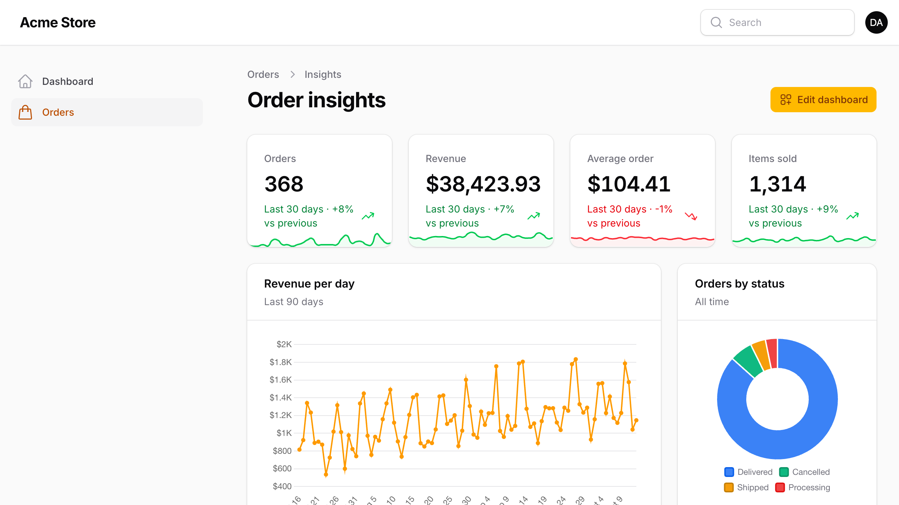
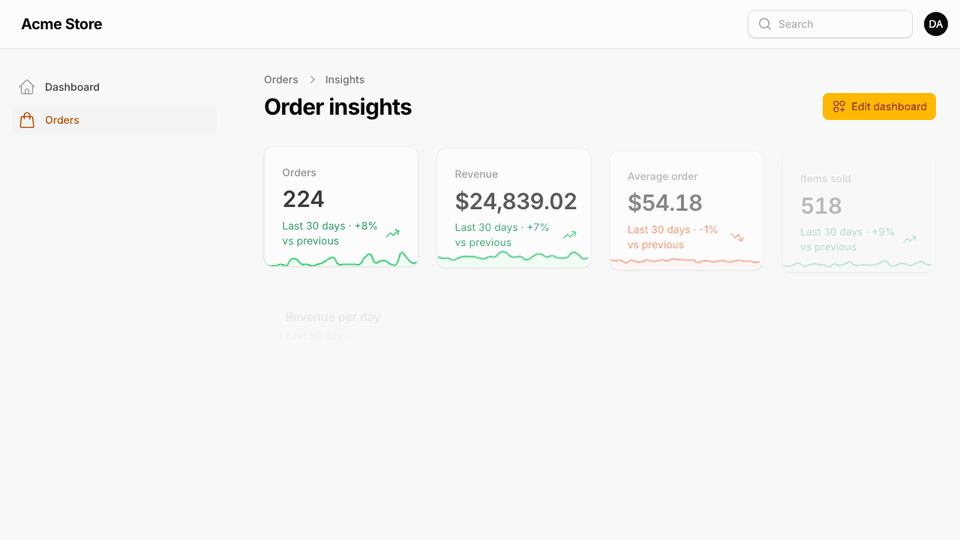

# Filament Insights

Admin-built stats and chart dashboards on any Filament resource. No data-source classes:
each dashboard reads from the resource's own list-page table query, so a chart counts exactly
the records its viewer could see in that table (`getEloquentQuery()` and `modifyQueryUsing()`
scopes both apply).

<div class="filament-hidden">

[](https://packagist.org/packages/carljanzell/filament-insights)
[](https://packagist.org/packages/carljanzell/filament-insights)
[](https://github.com/Darkify19/filament-insights/actions/workflows/ci.yaml)
[](https://github.com/Darkify19/filament-insights/blob/main/LICENSE)

</div>

Works on **Filament 3, 4 and 5** from one codebase: 3.3.53+, 4.13.2+ and 5.8.2+, the first
releases of each line without a known security advisory.

<picture>
  <source media="(prefers-color-scheme: dark)" srcset="https://raw.githubusercontent.com/Darkify19/filament-insights/main/art/dashboard-dark.png">
  
</picture>

## Install

```bash
composer require carljanzell/filament-insights
php artisan migrate          # creates insight_dashboards
php artisan filament:assets  # publishes the motion scripts; most apps run this via filament:upgrade
```

Register the plugin on a panel:

```php
use CarlJanzell\FilamentInsights\FilamentInsightsPlugin;

$panel->plugin(
    FilamentInsightsPlugin::make()
        // Who may edit dashboards. Anyone who can open the resource can view them.
        ->canManage(fn (): bool => auth()->user()?->hasRole('super_admin') ?? false)
        // Optional: existing hand-written widgets admins may place as-is.
        ->widgets([UsageStatsOverviewWidget::class])
        // Optional: lets admins show sums and averages as money (stats, axes, tooltips).
        ->currency('PHP'),
);
```

Add an insights page to a resource:

```php
class AttendanceInsights extends \CarlJanzell\FilamentInsights\Pages\InsightsPage
{
    protected static string $resource = AttendanceResource::class;
}

// AttendanceResource::getPages()
'insights' => Pages\AttendanceInsights::route('/insights'),

// ListAttendances::getHeaderActions() — a button to get there
AttendanceInsights::linkAction(),
```

## What admins can build

- **Section**: organize widgets into titled groups with a short description, optional icon,
  accent color, and optional viewer collapse/expand toggle. Drag widgets freely across sections
  or drop new widgets straight into a section via its `+` button or **Place in section**.
- **KPI Stat**: count / unique values (`count_distinct`) / sum / average / min / max, optionally
  over a rolling window (7–365 days) or calendar period (`Today`, `This week`, `This month`,
  `This year`) with change against the previous period, a trend sparkline, optional icon,
  accent color, and subtitle note.
- **Chart**: bar, line, pie or doughnut, grouped by hour / day / month / year of a date field, or
  by a field (top N), with optional accent colors and subtitle notes. Foreign keys show the
  related record's title, or its name or full name when that resource has none. A key with no
  row there is labeled from another relation on the same model when that id matches. Enums show
  their label.
- **Table**: ranked summary table grouped by any field (top N) or over time (`@hour` / `@day` /
  `@month` / `@year`), with formatted numbers or currency, inline `%` share bars, and a total
  footer row.
- **Per-widget filters**: narrow any stat, chart, or table with *"Only include records where..."*
  conditions (`is`, `is not`, `is any of`, `is none of`, `contains`, `>`, `>=`, `<`, `<=`,
  `is empty`, `is not empty`), with automatic dropdown options for enums, booleans, and
  `BelongsTo` relations.
- **Custom widget**: any widget registered with `->widgets()`.

Admins can add widgets from **Add widget** (with quick-start templates and a live plain-English
summary), create groups via **Add section**, edit, duplicate, resize, or remove any card directly
from its hover toolbar, toggle **Preview** to view the dashboard without edit controls, or manage
all items at once via **Manage all**. Admins rearrange a dashboard by dragging widgets and
sections on the page (press and hold on touch), or by focusing one and pressing Alt + arrow keys.
The order is saved for everyone who views it.



Widgets rise in one after another, stats count up as they load, a picked-up widget lifts over
a soft outlined slot, and a dropped one settles with a small spring. The motion runs on a
bundled [anime.js](https://animejs.com) 4.5 (MIT), imported only on insights pages and never
when the viewer's system asks for reduced motion. If the scripts aren't published, the
dashboard works the same without it.

Only real columns are offered. Hidden and encrypted attributes are excluded, and every
column name is checked against the table schema before it reaches SQL.

Keep a page's personal fields out of the picker with `$excludedColumns`, or override
`getExcludedColumns()` when it depends on the viewer. A saved widget that reads an
excluded column is skipped:

```php
class SalnInsights extends InsightsPage
{
    protected static string $resource = SalnResource::class;

    protected static ?string $title = 'SALN insights';

    protected static array $excludedColumns = ['spouse', 'spouse_office'];
}
```

## Limits

- Date grouping supports MySQL/MariaDB, PostgreSQL and SQLite.
- Accessors (computed attributes) can't be grouped or summed: they don't exist in SQL.
- Table filters and tabs are not applied; each widget sets its own period.

## For AI agents

The package ships an agent guide at
[`resources/boost/guidelines/core.blade.php`](resources/boost/guidelines/core.blade.php): setup,
the plugin methods, the page API, widget configs and common tasks. Apps using
[Laravel Boost](https://github.com/laravel/boost) pick it up automatically on
`php artisan boost:install` (or `boost:update`). Without Boost, point your agent at that file.
Working on the plugin itself: [AGENTS.md](AGENTS.md).

## Tests

```bash
composer install
composer test   # Pest, on an in-memory SQLite panel
composer lint   # Pint, read-only
```

CI runs the suite against every supported Filament line.
